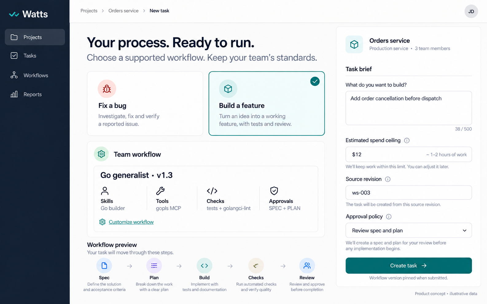
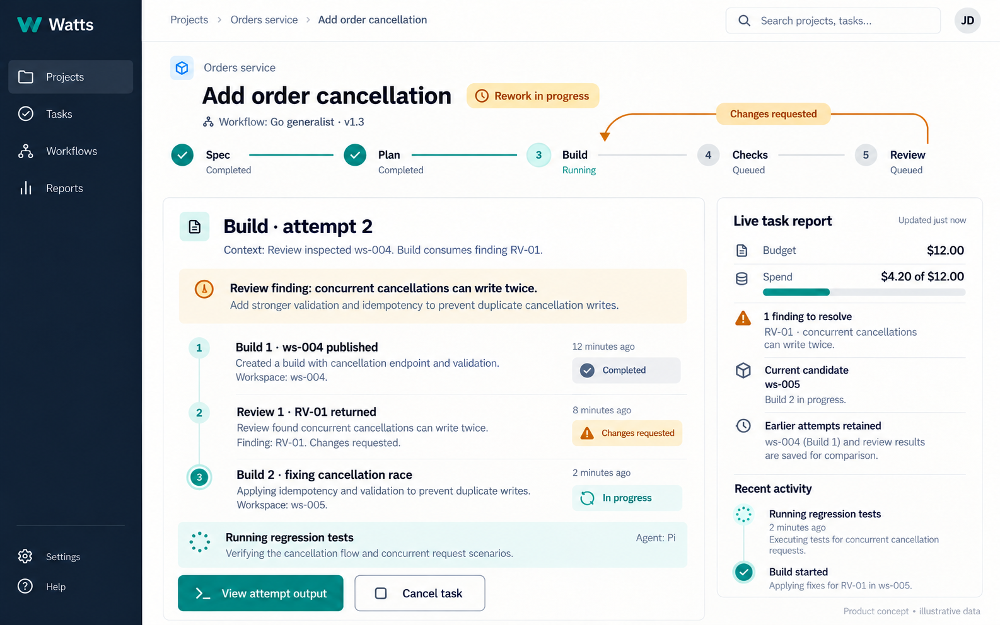
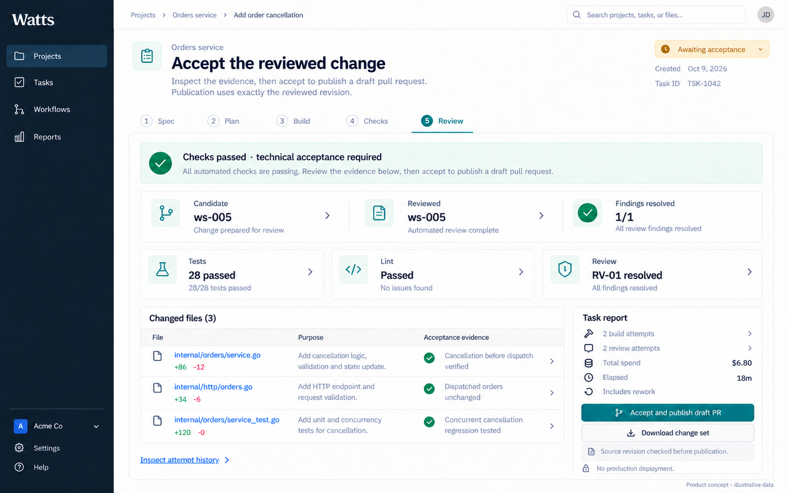
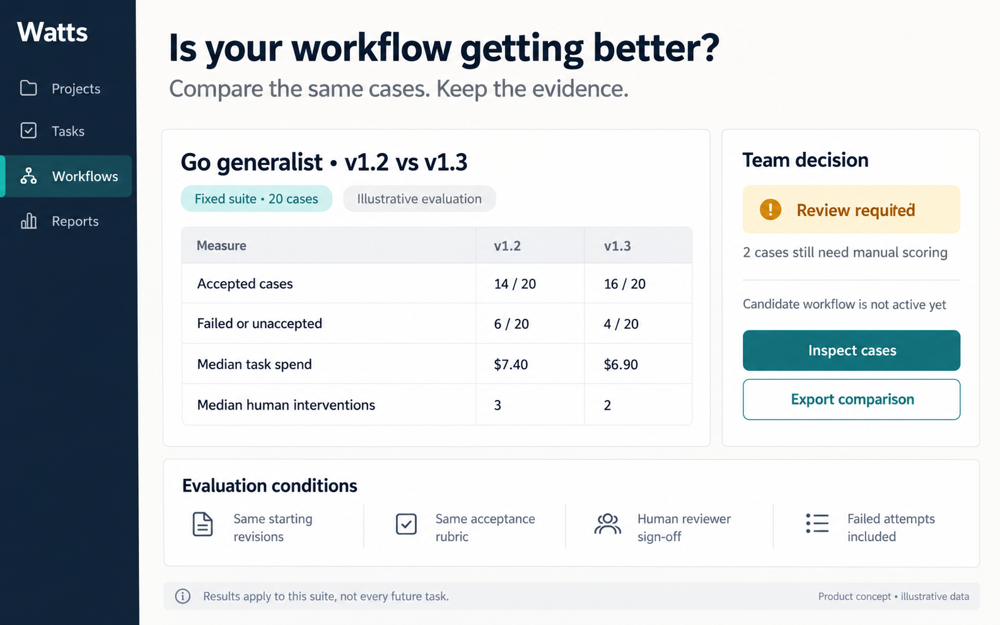

# Watts Platform

## The proposition

**Make agentic software development auditable, versioned, reproducible, and measurable.**

Watts gives teams a high-level abstraction and reusable building blocks for engineering their agentic software development process. Teams define workflows, run them under explicit contracts, record actions and outcomes, and use the evidence to improve the system over time.

Watts Platform makes that system easy to adopt and operate. It manages the infrastructure and integration work, while a library of workflows gives teams a practical starting point. Teams retain an inspectable, customizable, versioned definition of how their software work happens.

The central promise is a disciplined improvement cycle: **define → execute → measure → compare → revise**. Cost efficiency, token efficiency, quality, predictability, and human effort become properties the team can investigate and improve. Gains must be demonstrated through comparable outcomes and resource inputs.

Status: product hypothesis, reviewed 2026-10-12. Watts is a 0.1.0 proof of concept with typed YAML resources, values-driven templates, pinned local execution definitions, Temporal orchestration, and local Docker workload execution. Complete usage accounting, distributed execution packages, hardened sandboxing, and the managed platform remain open work. Pi/Ralph is an example workload image; local container execution does not establish hardened multi-tenant isolation. The images below are product concepts. See [current architecture](../watts/docs/workflow-design.md) and [proposed stage communication](../watts/docs/stage-communication.md).

## The problem: adoption without engineering rigor

The market thesis is that widespread AI engineering investment is not consistently translating into meaningful, demonstrable organizational outcomes. Giving engineers access to coding agents does not establish an effective development system.

The failure pattern Watts targets is individual engineers typing requests into Claude Code or Cursor, choosing prompts and tools, deciding when to plan or review, and improvising recovery. Each engineer is left to discover an effective workflow independently. Experiments remain local, successful practices are difficult to reproduce, and the organization learns little from its aggregate investment.

Without a defined process and comparable records:

- **Cost efficiency is unclear.** Subscription or API spend does not show the total cost of producing accepted work, including failed attempts, rework, verification, and human intervention.
- **Token efficiency is unclear.** Token counts may be available, but their relationship to useful outcomes is not established. Fewer tokens can mean efficiency, insufficient work, or lower quality.
- **Outcomes are disconnected from inputs.** Teams cannot reliably associate accepted quality with model usage, compute, elapsed time, and human effort.
- **Behavior is hard to predict.** Completion rates, failure modes, review burden, resource consumption, and recovery depend on an improvised process.
- **Workflow design is left to individuals.** Engineers repeatedly invent their own approaches without reusable primitives, a maintained starting point, or controlled evaluations.
- **Changes do not accumulate into organizational learning.** A different prompt, model, skill, or tool may appear better without a record of what changed or evidence from comparable runs.

The gap is the ability to engineer, maintain, and improve the development system as a team. Infrastructure assembly adds another barrier: connecting orchestration, agent execution, tools, storage, telemetry, and evaluation consumes time before the team can investigate whether its workflow is effective.

## What Watts gives the team

| Primitive or abstraction | What the team can do |
| --- | --- |
| Versioned workflow manifests | Define the process explicitly, track changes, and pin the definition used by a task |
| Procedures and execution contracts | Declare inputs, outputs, tools, checks, permissions, limits, and acceptance evidence |
| Agents and reusable resources | Compose instructions, skills, model settings, and MCP tools without rebuilding the surrounding lifecycle |
| Routing and rework | Make review-to-build loops, human decisions, failure handling, and retry boundaries explicit |
| Execution records | Trace actions, attempts, findings, artifacts, decisions, and accepted changes to the workflow that produced them |
| Outcome and resource metrics | Connect quality and acceptance to tokens, spend, compute, elapsed time, and human effort |
| Evaluation cases and rubrics | Compare workflow versions under declared conditions and retain human judgments |
| Shareable workflow packages | Reuse a team standard, adapt an existing workflow, and reproduce its execution conditions |

This is the target product contract, not a claim that every primitive is implemented today. The abstractions should reduce repeated integration work and provide a stable foundation for iteration. Teams remain responsible for defining useful outcomes and acceptance criteria.

Reproducibility means reconstructing the definition, inputs, dependencies, and execution conditions. It does not promise identical output from nondeterministic models or changing external services. Record model identifiers and runtime versions, and identify dependencies that cannot be fully pinned.

## What the managed platform adds

Watts provides the open abstractions. Watts Platform provides the managed environment in which teams use them:

- Hosted orchestration and execution, with isolated attempts and explicit artifact publication.
- Storage and retention for workflow versions, inputs, outputs, logs, findings, and reports.
- Collection and attribution of actions, outcomes, usage, and resource consumption.
- Evaluation runs and comparisons that support team decisions about workflow changes.
- Shared access, approval authority, scoped credentials, and audit records.
- A maintained workflow library, guided setup, and compatibility checks.

Customers should spend time refining their development process rather than repeatedly gluing infrastructure components together. The platform must preserve the team's ability to inspect, export, customize, and version that process.

Managed operations and quick setup support the value proposition. The central offering remains a system for rigorous, measurable agentic development.

## The improvement cycle

1. **Define.** Start from a maintained package and customize its workflows, agents, skills, tools, checks, approvals, and acceptance criteria.
2. **Execute.** Pin the selected configuration and record attempts, decisions, failures, artifacts, and available resource usage.
3. **Measure.** Assess accepted quality, resource consumption, reliability, and human intervention using declared cases and rubrics.
4. **Compare.** Evaluate a candidate configuration against the baseline under comparable conditions, retaining failures and uncertainty.
5. **Revise.** Adopt or reject the candidate, preserve its rationale and evidence, and continue observing real work.

Templates describe the intended process; execution records show what actually happened; evals connect a configuration to its outcomes and inputs. Without all three, an apparent improvement may reflect a model change, extra human effort, different task difficulty, or luck.

### Imagined product screens

All task details, timings, costs, and evaluation scores below are illustrative. These are proposed interfaces, not product performance evidence.

**Start with a reusable process and make it your team's.** The workflow includes skills, tools, checks, and approval policy.

**Keep the history of how work happened.** Review findings, candidate revisions, rework, and resource consumption accumulate in the task report.

**Tie acceptance to evidence.** Inspect the revision, verification, and effort behind the result before publication.

**Evaluate changes to the development system.** Compare versions on the same cases and rubric before adopting a new standard.

## Measure outcomes against resource inputs

The unit of analysis is a task or evaluation case executed under a particular workflow version. Stage and attempt records explain the aggregate result.

| Dimension | Record and compare |
| --- | --- |
| Outcome | Accepted, rejected, failed, cancelled, or pending; acceptance evidence and rubric scores |
| Quality | Criterion coverage, meaningful verification, unresolved findings, and human assessment |
| Tokens | Input, output, cached, and other provider-reported categories, with model and attempt attribution |
| Cost | Model charges, compute, storage, and attributable third-party charges; distinguish actuals from estimates |
| Compute | Available execution duration and resource usage; record the runtime/environment |
| Time | Execution, queueing, approval waits, review, and total elapsed time |
| Human effort | Recorded interventions and review effort, with measured versus self-reported values identified |
| Reliability | Acceptance rate, failure causes, retries, rework, and variation across comparable runs |

For a fixed evaluation batch, calculate total resource consumption per accepted case, including failed and abandoned attempts. Preserve task-level distributions so an average does not hide expensive failures. If no case is accepted, report that fact and total consumption; do not invent a finite cost per accepted case.

A team's target is useful accepted work at an appropriate quality bar and resource cost. A lower token count alone is not an improvement, and dollar savings are not equivalent to token savings across differently priced models. Declare which outcome and resource dimensions matter before comparing versions.

Keep the raw evidence behind every summary. Record the workflow version/hash, case and starting revision, instructions, model identifiers, runtime dependencies, rubric, and scorer. Unknown usage remains unknown. Repeated updates, retries, and worker restarts must not double-count consumption.

The task report evolves during execution, preserving failures and rework. Analysis may reveal repeated findings, expensive stages, unnecessary context, or a weak completion check. Teams use those observations to design and evaluate changes; automatic recommendations must remain evidence-linked and distinguish inference from observation.

## A library that reduces reinvention

A workflow package includes stages, instructions, skills, tool/MCP requirements, checks, routing, expected artifacts, compatible dependencies, and evaluation cases. It provides a maintained starting point with an explicit completion boundary.

Initial packages should cover bounded bug fixes and small feature changes for Go business applications and web services. Later packages can cover dependency upgrades, API changes, test improvements, and bounded refactoring.

Teams can configure a supplied package, fork it, or create their own. Shared primitives let them reuse a review stage, lint policy, or skill without reconstructing the whole system. Package changes are versioned and evaluated; adopting an update must not silently alter active tasks.

The library should grow through documented compatibility, observed failure modes, and evaluation evidence. A template gallery without maintenance or measurement does not establish an effective development process. Sharing requires separating portable definitions from project-specific credentials, private context, and artifacts.

## Architecture: Kubernetes for agentic workflows

The analogy describes a high-level, declarative contract over execution machinery. Teams define and version what should run, while the system resolves configuration, executes work, and records what happened.

The resource model separates responsibilities:

- **Workflow:** connects work, binds inputs, and owns routing, approval policy, and overall limits.
- **Procedure:** defines model-free work such as commands and checks; approval/event waits remain orchestration states.
- **Agent:** specializes executable work with a model, runtime, identity, instructions, skills, and tools.
- **ConfigMap and Secret:** supply scoped configuration and credential references.

A Watts package groups these resources; the proposed package model supports multiple named Workflows without an additional grouping Kind. Values-driven templates make the package customizable. An isolated workload is the proposed basic execution primitive for Agent and executable Procedure attempts; Pi and its Ralph tool run inside that boundary. Resource definitions, running instances, and execution evidence remain distinct.

The current core implements typed YAML resources, package templating/composition, pinned local definitions, and Temporal execution. The distributed target adds self-contained packages, isolated workspaces, explicit revision publication, and durable artifact transfer. Temporal retains workflow orchestration; a local container backend or Kubernetes can supply execution capacity. See [container workloads](../watts/docs/container-workloads.md) and [package/runtime separation](../watts/docs/package-runtime-layout.md).

The analogy should clarify ownership rather than dictate infrastructure scope. Customers should not need to operate Kubernetes or Temporal. Source-host publication is an adapter; Git is not a Watts core dependency.

## Why Watts alongside Claude Code or Cursor?

Claude Code provides skills, hooks, tools, subagents, and an Agent SDK. Cursor provides cloud agents and scheduled/event-driven automations. These products already support substantial automation. Feature context checked 2026-10-11: [Claude Code](https://code.claude.com/docs/en/overview), [Cursor Cloud Agents](https://cursor.com/docs/cloud-agent), [Cursor Automations](https://cursor.com/docs/cloud-agent/automations).

The problem Watts addresses is how an organization engineers and improves its use of agents. In the ad hoc pattern, the individual chooses the workflow and the organization lacks a comparable record of process, outcomes, and resource inputs. Watts makes the team process explicit, versionable, reusable, and measurable.

| Organization's question | Proposed Watts contribution |
| --- | --- |
| Which process produced this result? | A pinned workflow version and a trace of stages, attempts, decisions, and artifacts |
| What resources did the result consume? | Attributable metrics covering successful work, failures, and rework |
| Did a workflow change improve efficiency? | Comparable evaluations of quality and resource inputs, retaining earlier versions |
| Can another engineer reproduce the process? | Shareable manifests, reusable resources, and declared execution conditions |
| How do we stop every engineer starting from scratch? | Maintained workflow packages and reusable team building blocks |
| Who assembles and operates the underlying system? | Watts Platform supplies managed execution, storage, instrumentation, and evaluation operations |

A team can build a disciplined system with existing tools, scripts, CI, and observability. Watts must offer a useful abstraction and less integration work, not claim that other products cannot support rigor. Teams already satisfied with their process may have no reason to adopt it.

The target contract should support preferred coding tools as executors or coordinators. Claude Code and Cursor adapters are potential integrations, not existing Watts capabilities. The platform should preserve agent choice as supported adapters become available.

Temporal, Langfuse, LangSmith, and execution infrastructure can supply components. Watts' proposition is the coherent workflow abstraction and improvement cycle, with the platform managing the component assembly. Integration alone is insufficient if the resulting process remains opaque or hard to evaluate.

## A reasonable MVP

**A managed environment in which a team can define a Go development workflow, run it, measure its outcomes and inputs, and evaluate a revised version.**

Start with one supported Go service profile, one agent adapter, and two workflow packages: bounded bug repair and small feature implementation. The [Go generalist example](../watts/resources/examples/go_generalist/README.md) is a seed, not evidence of cloud readiness.

The minimum usable product includes:

- Versioned, validated workflow definitions and a file-based customization path for stages, skills, MCP tools, checks, and routing.
- Guided project setup, compatibility checks, managed orchestration, and isolated execution.
- Task/stage/attempt records, artifact/revision bindings, complete diagnostic output, explicit decisions, and recovery actions.
- An evolving report connecting outcomes with available token usage, spend, execution time, and recorded human intervention.
- Fixed evaluation cases, a shared rubric, manual scoring, and exportable comparisons between workflow versions.
- Controlled adoption of a candidate workflow and evidence linking each task to its selected version.
- Basic team access, tenant isolation, scoped credentials, spend limits, and evidence retention/export/deletion.
- Explicit publication of an accepted change set or draft pull request; no unattended production deployment.

An elaborate visual workflow editor or analytics suite is unnecessary. Files, clear task views, trustworthy records, and simple comparative reports are enough to test the proposition. Metrics and evaluation belong in the initial learning cycle; they cannot all be postponed while the product sells only agent hosting.

Defer multiple languages, broad executor support, a marketplace, automatic optimization, customer-operated clusters, dedicated enterprise deployments, and a large connector catalog. A customer should not need to learn Temporal or manage workers to use the hosted product.

MVP acceptance: a team can run a baseline workflow, change it, rerun declared cases, and inspect differences in outcomes and resource consumption. Failures remain in the comparison. The team can explain what changed, decide which version to adopt, and reproduce the setup without hidden operator work. A favorable comparison is not required; revealing that a change made things worse is useful functionality.

## Benefits to the enterprise

The enterprise value is a visible, governable process for agent work across teams. These are proposed benefits and engineering obligations, not claims that the prototype already provides enterprise controls or certified compliance.

| Benefit | What Watts Platform should provide | Honest boundary |
| --- | --- | --- |
| Observability | A task → workflow version → stage → attempt trace, with logs, tool events, findings, queue/wait time, and linked artifacts | Only instrumented actions are observable. Missing telemetry must be visible; a transcript is not proof that all external effects were captured. |
| Spend accountability | Usage and charges attributed to team, project, task, model, and attempt, including failures and rework; budgets and reconciliation with provider billing | Estimates and actual charges differ. Subscriptions, shared infrastructure, and unreported usage complicate allocation. Budget enforcement can have in-flight overshoot and must state its limits. |
| Safety and containment | Isolated workloads, restricted filesystem/network access, scoped credentials, resource limits, cancellation, and explicit publication authority | Prompt guardrails are not a sandbox. Containers require deliberate permissions and do not guarantee safe code, prevent every escape, or remove human accountability. |
| Auditability | Pinned definitions and input identities, attributable decisions, exact reviewed revisions, and retained verification/publication evidence | Ordinary logs are not tamper-evident audit records. Define integrity protection, access, retention, export, and deletion before making stronger claims. Model reasoning and every internal decision may not be observable. |
| Governance | Approved workflow versions, supported runtime/model policies, role-based approval authority, controlled exceptions, and a record of policy changes | A policy in a manifest is only a declaration until enforced. Changes and overrides require attributable authority; governance must not become a rubber-stamp approval process. |
| Data and credential control | Scoped delivery, tenant boundaries, evidence access controls, redaction, and explicit retention/provider policies | BYO keys do not prevent data from reaching a model provider. Residency, provider terms, backups, and sensitive transcript storage require separate decisions and verification. |
| Organizational learning | Reusable team processes and comparable evals tied to workflow revisions, accepted quality, resource use, and interventions | Comparisons depend on representative cases and consistent scoring. Metrics do not establish causality or justify ranking individual engineers by tokens or output volume. |
| Operational accountability | Clear ownership of failed work, compatible runtime versions, recovery procedures, and exportable definitions/evidence | Managed operations transfer infrastructure work, not responsibility for acceptance criteria or the correctness of published software. Availability and portability promises require tested recovery and export paths. |

A practical management question is: **Which approved process produced this change, who authorized it, what did it consume, and what evidence supports accepting it?** Watts should make that answer available without reconstructing several disconnected systems.

Capabilities should be phased. The hosted MVP needs tenant isolation, scoped credentials, attributable decisions, usable evidence, and honest usage reporting. Enterprise procurement may additionally require SSO, fine-grained roles, protected audit retention, residency options, incident response commitments, and external assurance. Those are substantial product and operating commitments; none should be implied by calling the platform “enterprise-ready.”

Current evidence sets a clear limit: the [local Go eval](../watts/evals/go-workflow/runs/2026-10-10-tic-tac-toe/README.md) produced a verified game but exposed missing build/review token accounting, interrupted executor recovery problems, mixed worker versions, and a review metadata false positive. It demonstrates useful failure evidence and work still required, not reliable end-to-end delivery or quantified savings.

## What businesses might pay for

The buyer is an engineering leader or owner of a software delivery function who wants a rigorous, maintainable agent development system. Smaller teams and non-technology companies with limited platform engineering capacity are plausible early customers; they still need a technical owner and meaningful acceptance criteria.

Paid value is maintained workflow packages plus managed execution and the evidence/control layer described above. Enterprises may value accountability and governance even before efficiency gains are proven, but willingness to pay and procurement requirements must be tested. Smaller customers may prefer a simpler offer; do not force every buyer through enterprise machinery.

A subscription could cover workflow/version management, collaboration, reporting, evaluations, retention, and support, with understandable execution and model charges. Validate packaging and willingness to pay through pilots rather than assuming demand for another dashboard. Track support and onboarding costs separately from execution costs.

## Critical assessment and validation

The idea is credible if teams can use the abstractions to build a measurable development system with less reinvention and integration work. Positive efficiency gains are an empirical question. Auditability makes experiments assessable; it does not make a poor workflow effective.

The principal risks:

- More stages and agents can increase token consumption, latency, and human review without improving quality.
- Versioned manifests cannot make models deterministic or compensate for inadequate context and acceptance criteria.
- Incomplete usage attribution or inconsistent scoring can produce misleading efficiency comparisons.
- Teams may collect metrics without making disciplined changes or may find simpler automation sufficient.
- Coding tool vendors and observability platforms can expand into workflow management and evaluation.
- A workflow library can become stale, incompatible, or expensive to support across diverse projects.
- Security, sensitive evidence, credential handling, and tenant isolation are operating obligations, not optional later polish.

Recruit a small set of teams with recurring work and a technical owner. Establish their actual Claude Code/Cursor-plus-CI baseline, include unsuccessful tasks, and record setup effort, review burden, accepted quality, tokens, spend, and elapsed time. Have them make and evaluate workflow changes rather than merely watch a hosted agent run.

Look for repeat use, understandable evidence, reuse of definitions, changes informed by comparisons, and willingness to pay for the managed system. Evaluate efficiency at the team's declared quality bar. Do not substitute prompt volume, generated code, or an isolated successful demo for improved delivery.

Narrow or stop if customers only want a hosted terminal, cannot connect resource inputs to outcomes, never use the iteration loop, or achieve the same useful process with simpler existing tooling. Payment and renewal must eventually support the cost of infrastructure, library maintenance, and support.

## Evidence notes

The research supports investigating workflow quality and measurable organizational outcomes, not a universal claim that AI engineering fails. DORA's March 2026 analysis describes verification overhead, a workflow gap, and the importance of measuring impact rather than generated output; it also reports positive individual productivity perceptions and an association with higher throughput. These mixed findings motivate disciplined measurement. [DORA: Balancing AI tensions](https://dora.dev/insights/balancing-ai-tensions/).

METR's early-2025 experiment found a slowdown in a particular experienced open-source developer setting. Its February 2026 update describes selection and measurement difficulties in the follow-up study. Treat those findings as scoped evidence that outcomes and perceptions can diverge, not a current universal estimate for companies, tools, or Watts. [METR: experiment design update](https://metr.org/blog/2026-02-24-uplift-update/).

The specific prevalence of ad hoc workflow use, the scale of the organizational efficiency gap, and willingness to adopt Watts remain customer-research questions. An “overwhelming majority” claim needs a defined company population and meaningful-outcome measure before being presented as a statistic. A lack of measured improvement is also different from evidence of no improvement.

## The decision

Build the smallest managed system that lets a team define a process, run it reliably, and evaluate a revision. Expand enterprise controls as validated customer requirements, with enforcement and evidence behind each promise.

**Teams should be able to build, maintain, and improve their agentic software development system over time—and show what each change achieved.**
